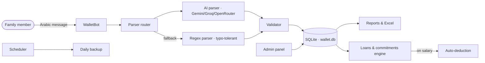

<div align="center">

# 💰 محفظة — WalletBot

### Family expense manager for Telegram — in plain Arabic

Just write what you spent. The bot understands, categorizes, tracks loans
and savings, and builds your reports — from an Android phone via Termux.

[](https://www.python.org/)
[](https://docs.python-telegram-bot.org/)
[](https://termux.dev/)
[](https://www.sqlite.org/)
[](LICENSE)

</div>

---

## ✨ Features

| Area | What it does |
|------|--------------|
| 💬 **Natural input** | `500 اكل` or `راتب 750 الف` — no verbs needed; Arabic-Indic digits supported |
| 🧠 **AI first, regex fallback** | Every message tries AI (Gemini / Groq / OpenRouter) first, regex if offline |
| 🏷️ **Categories** | ~40 categories, ~142 synonyms, typo-tolerant (`بانزين` → fuel, `صيدليه` → medicine) |
| 💸 **Loans** | Track advances; auto-deduct from each salary until fully repaid |
| 💳 **Installments** | Installment count computed automatically from price ÷ payment |
| 🔄 **Recurring commitments** | Rent, subscriptions, bills — auto-deducted on salary with per-item toggle |
| 🎯 **Savings goals** | Create goals and follow progress with a text progress bar |
| 📊 **Excel reports** | Full 7-sheet financial report with charts (summary, transactions, categories, income, commitments, deductions, savings) |
| 💾 **Backup & restore** | Automatic daily backups + one-tap restore from the admin panel |
| 🤖 **AI admin** | Pick a free OpenRouter model from a live list, manage API keys, test the connection |
| 🔐 **Silent admin** | `/admin` answers nothing at all to non-admins — not even a refusal |

## 🏗️ Architecture



## 📁 Project structure

```
├── bot.py                 # Entry point (long polling)
├── config.py              # Settings
├── termux_check.py        # 20-point Termux compatibility self-check
├── parser/                # Message understanding
│   ├── parser_engine.py   # Routing: AI first, regex fallback
│   ├── ai_parser.py       # AI extraction (JSON mode)
│   ├── regex_parser.py    # Typo-tolerant regex + synonyms
│   └── validator.py       # Transaction validation
├── ai/                    # AI providers
│   ├── router.py          # Provider routing & fallback
│   ├── providers.py       # Gemini / Groq / OpenRouter
│   └── prompts.py         # Dynamic system prompt (built from live categories)
├── database/              # SQLite (aiosqlite)
│   ├── db.py              # Connection & queries
│   ├── models.py          # Schema
│   └── migrations.py      # Safe upgrades for existing databases
├── handlers/              # Telegram handlers
│   ├── messages.py        # Natural-language transactions
│   ├── user.py            # User menu (summary, history, balance)
│   ├── loans.py           # Loans
│   ├── installments.py    # Installments
│   ├── commitments.py     # Recurring commitments
│   ├── savings.py         # Savings goals
│   ├── reports.py         # Reports
│   ├── excel.py           # Excel export
│   ├── admin.py           # Admin panel
│   ├── ai_admin.py        # AI settings (model picker, keys, test)
│   ├── backup.py          # Backup & restore
│   └── settings.py        # User settings
├── reports/               # Balance, monthly, statistics
├── backup/                # Backup & restore engine
├── utils/                 # Categories, currency, dates, reply, security
├── tests/                 # Tests (carry-forward, ...)
├── .env.example           # Environment template
└── requirements.txt       # Dependencies (pure Python only)
```

## 🚀 Quick start

```bash
# 1. Install dependencies
python3 -m pip install -r requirements.txt

# 2. Configure
cp .env.example .env
chmod 600 .env
# fill BOT_TOKEN (from @BotFather) in .env

# 3. Verify the environment (recommended on Termux)
python3 termux_check.py

# 4. Run
python3 bot.py
```

Every dependency is **pure Python** — no Rust or C/C++ compilation, so
installation works on Termux/ARM64 with plain `pip install`.

## ⚙️ Configuration

| Variable | Required | Description |
|----------|----------|-------------|
| `BOT_TOKEN` | ✅ | Bot token from [@BotFather](https://t.me/BotFather) |
| `ADMIN_ID` | ✅ | Admin's numeric Telegram ID |
| `TIMEZONE` | — | Default: `Asia/Baghdad` |
| `DEFAULT_EXCHANGE_RATE` | — | IQD per USD (default: `1500`) |
| `BACKUP_KEEP_COUNT` | — | Daily backups kept (default: `7`) |
| `AUTO_BACKUP_HOUR` | — | Backup hour (default: `3`) |
| `SECRET_KEY` | — | Auto-generated on first run if left empty |

## 💡 Usage examples

```
500 اكل            → مصروف 500 على الأكل
راتب 750 الف       → دخل راتب 750,000 (مع استقطاعات السلف تلقائيًا)
50 الف ويسكي       → مصروف 50,000 على المشروبات
استلمت 1$          → دخل 1 دولار (يُحوَّل بالسعر الافتراضي)
```

Unknown words are recorded under «أخرى» with the original word kept as a
note — the bot never rejects a message that contains a number.

## 🧪 Tests

```bash
python3 -m unittest discover -s tests -v
python3 termux_check.py   # 20-point environment & logic self-check
```

## 🖥️ Deployment

Production runs on a **Nokia 6.1 (Termux, Android 10)** inside the `bots`
tmux session. The bot runs as a single instance; a second instance causes
Telegram `getUpdates` conflicts.

## 📄 License

[MIT](LICENSE) — Copyright (c) 2026 tahagamer712-beep.
